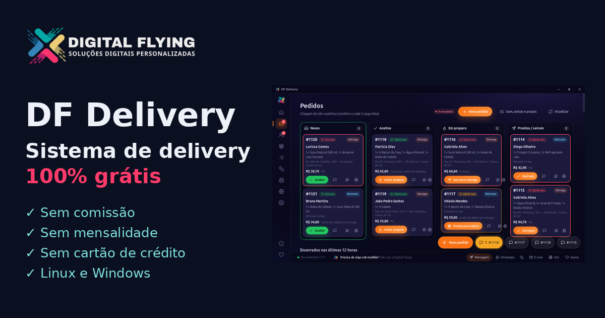
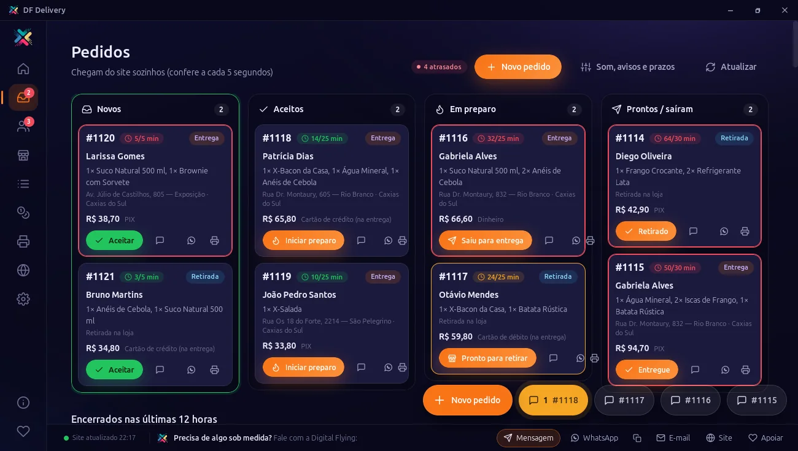
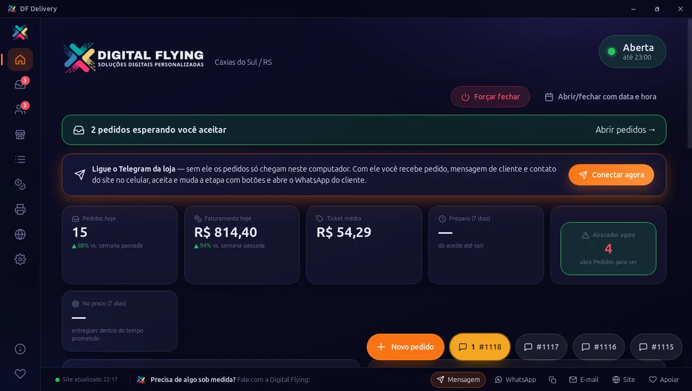
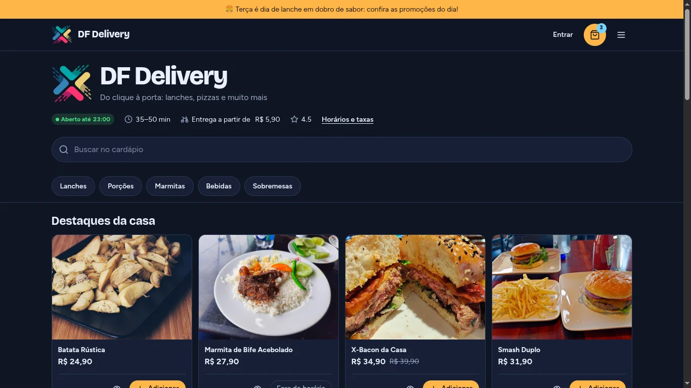
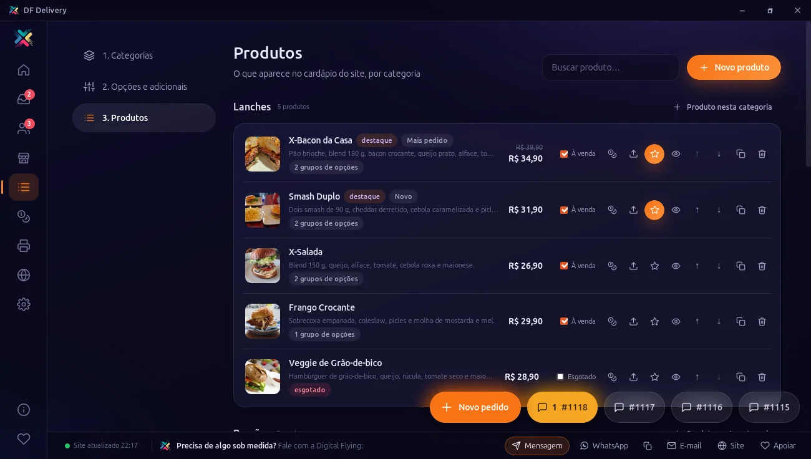
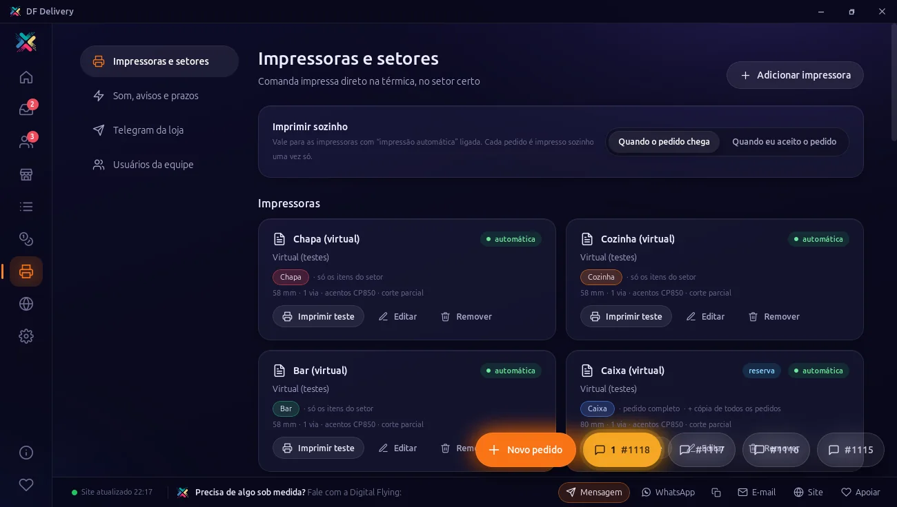
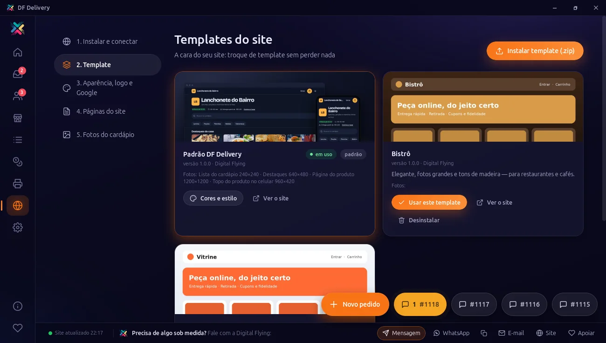

  

<h1 align="center">DF Delivery</h1>

  <b>Teu delivery grátis. Tua marca. Zero comissão.</b> 
  App para o computador da loja que toca alarme e imprime cada pedido, mais o site de pedidos com a tua cara.

  <a href="https://github.com/edersoncxs/digitalflying-info/releases/latest/download/df-delivery_x64-setup.exe"><b>⬇ Baixar para Windows</b></a> ·
  <a href="https://github.com/edersoncxs/digitalflying-info/releases/latest/download/df-delivery_amd64.deb"><b>⬇ Ubuntu / Mint / Debian (.deb)</b></a> ·
  <a href="https://github.com/edersoncxs/digitalflying-info/releases/latest/download/df-delivery.x86_64.rpm"><b>⬇ Fedora / openSUSE (.rpm)</b></a> ·
  <a href="https://dfdelivery.netlify.app/"><b>Conhecer o site</b></a>

  100% grátis · Sem mensalidade · Sem comissão · Sem cartão de crédito · Linux e Windows

---

## Como funciona

1. **Instala e cadastra.** Instala o app no computador da loja e cadastra o cardápio. O guia mostra cada passo, na ordem certa.
2. **O app sobe o teu site.** O próprio app instala o site de pedidos na tua hospedagem, com o teu domínio. Sem técnico.
3. **Pedido chega, toca e imprime.** O cliente pede pelo site. No balcão, o alarme toca, a comanda sai e tu acompanhas cada etapa.

## No balcão: nenhum pedido se perde

- **Alarme que toca até aceitar**, com a janela aberta, minimizada ou na bandeja.
- **Quadro de pedidos com relógio** que fica amarelo e vermelho quando atrasa.
- **Impressão automática por setor** (cozinha, chapa, bar), com impressora de reserva se uma falhar.
- **Pedido de balcão, telefone e WhatsApp** lançado no mesmo lugar, com o mesmo cálculo do site.
- **Internet caiu?** O app continua lançando e imprimindo no balcão; o que entrar pelo site aparece quando a conexão voltar.

## Para o teu cliente: pedir é fácil, pagar também

- Cardápio com fotos e adicionais, busca e status de aberto ou fechado.
- Endereço pelo CEP ou pelo nome da rua, já com bairro.
- **PIX com QR Code já com o valor**, dinheiro com troco ou cartão na entrega.
- Acompanha o pedido em tempo real e conversa com a loja pelo chat.
- "Pedir de novo" com os mesmos adicionais, num toque.

## Vende mais sozinho

- **Cupons** em % ou R$, frete grátis, só no primeiro pedido, por código.
- **Promoções automáticas** por dia, horário, produto ou categoria.
- **Cartão fidelidade** de carimbos, com recompensa aplicada sozinha.
- **Frete por bairro ou por km**, com frete grátis acima de um valor.
- **QR Code do cardápio** para imprimir e site preparado para o Google.
- **Telegram no celular:** pedido novo com botões para aceitar e avançar, conversa com o cliente e abrir ou fechar a loja de onde estiveres.

<table>
  <tr>
    <td width="33%"></td>
    <td width="33%"></td>
    <td width="33%"></td>
  </tr>
  <tr>
    <td align="center">Cardápio com ações rápidas</td>
    <td align="center">Impressão por setor</td>
    <td align="center">Templates e temas do site</td>
  </tr>
</table>

## O cliente, os dados e o site são teus

- **Tua hospedagem, teu domínio:** o site fica onde tu contratares, com o endereço da tua loja.
- **Dados no teu computador:** clientes e pedidos ficam contigo, com cópia no site e backup automático todo dia.
- **Sem comissão por pedido:** num faturamento de R$ 10.000 por mês, um marketplace pode levar mais de R$ 1.300. Aqui, R$ 0. O único custo é a hospedagem, paga direto ao teu provedor.

---

## Baixar e instalar

| Sistema | Baixar | Como instalar |
|---|---|---|
| **Windows 10 e 11** | [df-delivery_x64-setup.exe](https://github.com/edersoncxs/digitalflying-info/releases/latest/download/df-delivery_x64-setup.exe) | Dois cliques e **Instalar**. Se aparecer *"O Windows protegeu o computador"*, clique em **Mais informações → Executar assim mesmo**. |
| **Ubuntu 22.04+, Linux Mint 21+, Debian 12+ e derivados** | [df-delivery_amd64.deb](https://github.com/edersoncxs/digitalflying-info/releases/latest/download/df-delivery_amd64.deb) | Dois cliques e **Instalar**, ou no terminal: `sudo apt install ./df-delivery_amd64.deb` |
| **Fedora, openSUSE e derivados** | [df-delivery.x86_64.rpm](https://github.com/edersoncxs/digitalflying-info/releases/latest/download/df-delivery.x86_64.rpm) | `sudo dnf install ./df-delivery.x86_64.rpm` |

**Para o site de pedidos** precisas de uma hospedagem comum com PHP 8.1 ou mais (o banco pode ser SQLite, sem configurar nada, ou MySQL). O app instala o site sozinho; é só informar os dados da hospedagem.

**Atualizações:** o app avisa sozinho quando sai versão nova, mostra o que mudou e como atualizar. Teus dados são preservados. Todas as versões ficam em [Releases](https://github.com/edersoncxs/digitalflying-info/releases).

---

## Por que é grátis?

Estamos lançando o DF Delivery na Serra Gaúcha e queremos lojistas usando de verdade. **Quem instala a versão 1 usa para sempre, sem pagar nada**, e recebe correções e melhorias. Em troca, nos conta o que funciona e o que pode melhorar.

**Lojista fundador:** quem usa a versão 1 agora ganha desconto na versão 2, que vai trazer app para celular, entregadores, pagamento online com baixa automática e mais automações.

## Serviços opcionais, por orçamento

Instalação e configuração completa · Identidade visual da loja · Template exclusivo do site · Funções sob medida.

## Fala direto com quem fez

Dúvida, ideia ou problema: fala com a equipe da Digital Flying, sem robô e sem fila. Também ajudamos na escolha da hospedagem.

- **Site:** [dfdelivery.netlify.app](https://dfdelivery.netlify.app/#contato)
- **WhatsApp:** [(48) 99127-9653](https://wa.me/5548991279653)
- **E-mail:** [ederson.cxs@gmail.com](mailto:ederson.cxs@gmail.com)
- **Dentro do app:** ícone de coração no menu lateral (Digital Flying — contato, PIX e sugestões)

DF Delivery é um produto da <a href="https://digitalflying.netlify.app/">Digital Flying</a> · Caxias do Sul, RS

